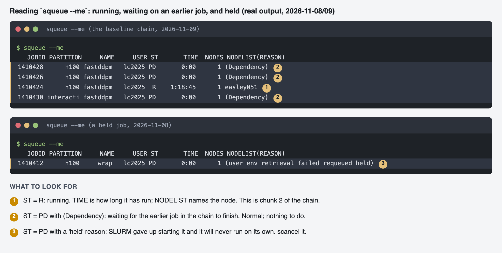
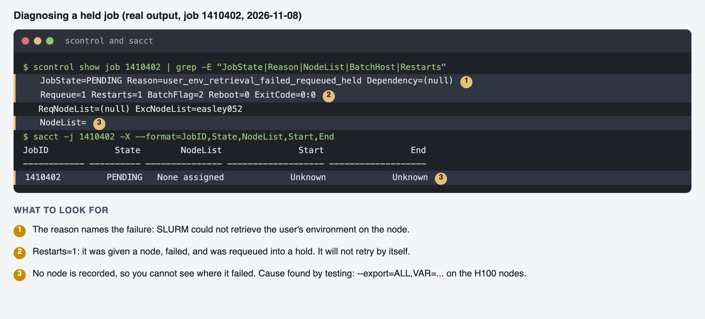
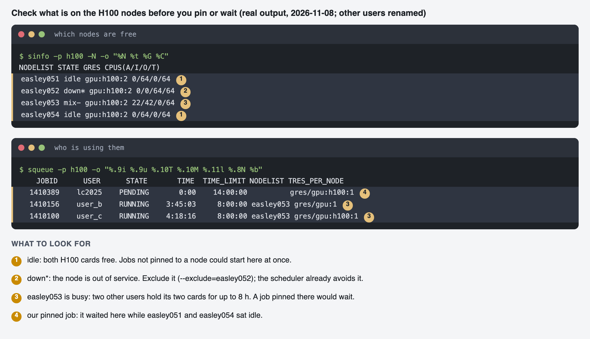

# Tutorial: Running Fast-DDPM on the UNM Alliance HPC Cluster

This document is written so someone else in the lab, starting from a clean
account, can reproduce this project's environment and results end to end.
Fill in the `<...>` placeholders as they're confirmed (partition names,
dataset paths, etc.) — this file should be updated as the project progresses,
not written once and left stale.

## 1. Cluster resources

| Cluster | Nodes | GPUs | Interconnect | Use for |
|---|---|---|---|---|
| Easley | 65 | 36× L40S + 8× H100 | NDR 800 Gbps InfiniBand | **All work** — only cluster we have direct login access to |
| Hopper | 61 | 37× NVIDIA A100 (80GB) | HDR 400 Gbps InfiniBand | Not reachable from this account (no separate Hopper login found) |

**Revised plan (pivoted from the original Hopper-first plan):** Fast-DDPM
pins PyTorch 1.12.1, which predates official H100 (`sm_90`)/L40S (`sm_89`)
support — the original plan was to baseline on Hopper's A100s (a hardware
match to the paper) and defer Easley until later. Since we only have Easley
access, we run everything here from the start using a **modern PyTorch build
(2.2.2)** instead of the paper's pinned 1.12.1. Consequence: our numbers
won't be a bit-for-bit reproduction of the paper's Table I (different
torch version + different GPU architecture), but should land close — worth
stating explicitly in any writeup, not a blocker.

This also narrows the Semester 2 "hardware comparison" idea (§9) from a
3-way A100/H100/L40S comparison down to L40S vs. H100, both on Easley.

**GPU resource names for `srun`/`sbatch --gres`:** `gpu:l40s` and (assumed,
verify before use) `gpu:h100`. Confirmed via:
```bash
scontrol show node <nodename> | grep -i gres
```
**Default to L40S for day-to-day work** — 36 available vs. only 8 H100s, so
allocations come through faster. Reserve H100 time for when you specifically
need it.

Full scheduler, QOS-limit, storage and measured-performance notes, with the
commands used to find each one: [easley_cluster_notes.md](easley_cluster_notes.md).

## 2. Account setup: SSH keys and Git/GitHub auth

These are the steps we worked through getting `ECE_551_problems_ML` pushed to
GitHub from the cluster login node — documented here so it isn't rediscovered
from scratch next time.

**Set your git identity** (a fresh account auto-fills name/email from your
username + hostname, which you don't want on your commits):
```bash
git config --global user.name "Your Name"
git config --global user.email "the-email-your-GitHub-account-uses@example.com"
```

**GitHub no longer accepts account passwords over HTTPS git** (disabled in
2021). Use SSH keys instead:
```bash
ls -la ~/.ssh                          # check if a key already exists
ssh-keygen -t ed25519 -C "your_github_email@example.com"   # if not
cat ~/.ssh/id_ed25519.pub              # copy this output
```
Paste the copied key into GitHub: Settings → SSH and GPG keys → New SSH key.

**Load the key and verify:**
```bash
eval "$(ssh-agent -s)"
ssh-add ~/.ssh/id_ed25519
ssh -T git@github.com
# Expect: "Hi <username>! You've successfully authenticated, but GitHub does not provide shell access."
```

**Clone/push using the SSH remote**, not HTTPS:
```bash
git remote set-url origin git@github.com:<username>/ECE_551_problems_ML.git
git push -u origin main
```

If `ssh -T git@github.com` still fails after adding a key, check which key is
actually being offered:
```bash
ssh -vT git@github.com   # look for "Offering public key: ..." — confirm it matches the one on GitHub
```

## 3. Bringing Fast-DDPM into the repo (fork + submodule)

We modify Fast-DDPM's own files directly (new dataset classes, new `elif`
dispatch branches — see §7), so it's tracked as a **fork added as a git
submodule**, not an unmodified dependency. This keeps a clean line between
upstream (`mirthAI/Fast-DDPM`) and our changes, while still letting us pull
upstream fixes later if wanted.

**One-time setup:**
1. On github.com, fork `mirthAI/Fast-DDPM` to your own account (Fork button,
   top right of the repo page).
2. On the cluster, inside your project repo:
   ```bash
   cd ~/ECE_551_problems_ML
   git submodule add git@github.com:<your-username>/Fast-DDPM.git fast-ddpm
   git commit -m "Add Fast-DDPM as submodule (forked from mirthAI/Fast-DDPM)"
   git push
   ```
   (Uses the same SSH key already set up in §2 — it authenticates you to all
   your repos, not just this one.)

**Anyone cloning the full project needs the submodule pulled in too:**
```bash
git clone --recurse-submodules git@github.com:<your-username>/ECE_551_problems_ML.git
# or, if already cloned without that flag:
git submodule update --init --recursive
```

**Making changes inside the submodule** — this is the one workflow habit
submodules require that a normal repo doesn't: commit inside the submodule
first, then record the pointer update in the parent repo.
```bash
cd fast-ddpm
git checkout -b add-<newname>-dataset
# ... make edits (new datasets/<NEWNAME>.py, new config, elif branches — see §7) ...
git add -A
git commit -m "Add <NEWNAME> dataset support"
git push origin add-<newname>-dataset      # pushes to YOUR fork
cd ..
git add fast-ddpm                            # records the new submodule commit pointer
git commit -m "Bump fast-ddpm submodule: add <NEWNAME> dataset support"
git push
```

## 4. Environment setup

**Verified working recipe on Easley (L40S, driver 570.211.01, CUDA 12.8).**
Deviates from the paper's pinned Python 3.10.6 / PyTorch 1.12.1 because
1.12.1 predates L40S/H100 kernel support — see §1 for why.

There is no `requirements.txt` in the upstream repo despite the README
referencing one, and the README's own listed versions
(`torch==1.12.1` + `torchvision==0.15.2`) are actually an invalid pairing
(0.15.2 belongs with torch 2.0.x). Installed manually instead:

```bash
# Package installs do NOT need a GPU — run these on the login node,
# not inside an srun allocation, so you're not racing a walltime limit.
conda create -n fastddpm python=3.10.6 -y
conda activate fastddpm
pip install torch==2.2.2 torchvision==0.17.2 --index-url https://download.pytorch.org/whl/cu121
pip install tqdm tensorboard tensorboardX scikit-image medpy pillow scipy
pip install "numpy<2"            # torch 2.2.2 was built against NumPy 1.x ABI — see troubleshooting log
pip install "opencv-python<4.10"  # opencv-python>=5.0 requires numpy>=2, conflicts with the pin above
pip install pyyaml pandas lmdb matplotlib requests   # imported by the code but absent from the README's list — see troubleshooting log
pip check                          # confirm no other conflicts before moving on
```

**Full dependency list, verified working** (README's own list was incomplete —
`pyyaml`, `pandas`, `lmdb`, `matplotlib`, `requests` are all imported
somewhere in the codebase but never mentioned):
`torch==2.2.2`, `torchvision==0.17.2`, `numpy<2`, `opencv-python<4.10`,
`tqdm`, `tensorboard`, `tensorboardX`, `scikit-image`, `medpy`, `pillow`,
`scipy`, `pyyaml`, `pandas`, `lmdb`, `matplotlib`, `requests`.

Sanity check (this part *does* need a GPU allocation — see §5 for the
`srun` command):
```bash
python -c "import torch, numpy, cv2; print(torch.__version__, numpy.__version__, cv2.__version__, torch.cuda.is_available(), torch.cuda.get_device_name(0))"
```
Expected: `2.2.2+cu121 1.26.4 4.9.0 True NVIDIA L40S` — no NumPy ABI warning
above the output.

## 5. SLURM basics for this cluster

Confirmed partitions (`sinfo`): `h100` (2-day limit, 4 nodes x 2 H100) and `l40s`
(2-day limit, 3 nodes x 4 L40S) for real GPU training runs; `interactive` (4hr
limit, 1 node per user) for debugging/smoke tests; `debug` (1hr); `scavenger`
(2-day, preemptible). **`general` has no GPUs** (CPU only), so do not use it for
GPU jobs. See [easley_cluster_notes.md](easley_cluster_notes.md).

**Note:** `<gpu_partition>` and similar `<...>` markers in this doc are
placeholders to replace, not literal text — bash will try to interpret
`<name>` as input redirection and fail with "No such file or directory" if
pasted as-is.

Interactive GPU session (for debugging/smoke tests, not long training runs —
note the 4hr cap on this partition):
```bash
srun --partition=interactive --gres=gpu:l40s:1 --time=00:30:00 --pty bash
```
**Only request the GPU allocation for steps that actually need a GPU**
(running `nvidia-smi`, importing `torch.cuda`, actual training/sampling).
`conda create`/`pip install` don't need one — run those on the login node so
they're not racing the allocation's walltime (see §4's install failure in
the troubleshooting log for why this matters).

Batch job template for real training runs (fill in the remaining
placeholders — dataset/config/exp path are yours to choose):
```bash
#!/bin/bash
#SBATCH --job-name=fastddpm-smoke
#SBATCH --partition=l40s
#SBATCH --gres=gpu:l40s:1
#SBATCH --cpus-per-task=8
#SBATCH --mem=64G
#SBATCH --time=02:00:00
#SBATCH --output=logs/%x-%j.out

source ~/.bashrc          # or wherever conda init lives on this system
conda activate fastddpm

cd ~/ECE_551_problems_ML/fast-ddpm   # relative paths in configs require this
python fast_ddpm_main.py --config <task>.yml --dataset <TASK> --exp <exp_path> --doc <run_name> --sample --fid
```

**Storage note:** point `--exp` and any downloaded data at scratch storage,
not `$HOME`. On this cluster the scratch filesystem is `/carc/scratch`, and
each user gets a pre-made symlink at `~/carc-scratch` pointing to their own
subdirectory (`/carc/scratch/users/<netid>`) — already set up by the admins,
no request needed. Layout used so far:
- `~/carc-scratch/fastddpm-data/data/<TASK>_{train,test}` — extracted
  datasets (from the processed bundle, Google Drive file id
  `1kF0g8fMR5XPQ2FTbutfTQ-hwG_mTqerx`, linked from the Fast-DDPM README;
  fetch with `gdown <file_id> -O <output.zip>` — note `gdown` dropped the
  `--id` flag in recent versions, pass the id positionally)
- `~/carc-scratch/fastddpm-exp/logs/<doc>/ckpt_<N>.pth` — checkpoints (see
  §7 for why pretrained checkpoints need renaming to fit this pattern)

Point config `data.train_dataroot`/`sample_dataroot` at the **absolute**
scratch path — do not copy dataset files into `fast-ddpm/` itself, that's a
git submodule and multi-GB image data has no business anywhere near it.

### 5a. Job shapes: telling the different kinds of runs apart

(To decide which partition, GPU and shape a task needs, and what limits apply, see
[run_options_and_bounds.md](run_options_and_bounds.md).)

"A job ID" does not say how a run was launched. These are the shapes used in this
project; always record which one a result came from.

**Rule of thumb.** One job ID = one allocation = whatever `--gres` it asked for.
SLURM confines a job to its own GPUs (`CUDA_VISIBLE_DEVICES`), so inside a job
`nvidia-smi` shows only those cards, even on a 4-GPU node. Two jobs on one node
use different cards and cannot touch each other's memory.

| Shape | How it is launched | Job IDs in `squeue` | GPUs per ID | Runs at the same time? | Used here for |
|---|---|---|---|---|---|
| **Single job** | `sbatch script.sh` | `1399885` | what `--gres` says (so far 1) | n/a | inference reproduction, training smoke test, resume |
| **Job array** | `#SBATCH --array=0-1` | `1398929_0`, `1398929_1` | each task gets its own allocation (1 each) | **yes**, if GPUs are free | batch-size tests, learning-rate test |
| **Dependency chain** | `sbatch --dependency=afterany:<id> ...` | `1399885`, then `1399886` | 1 each | **no**, the second waits (`(Dependency)`) | evaluating the two LR runs one after the other; later, the 400,000-step baseline split into resumable jobs |
| **Multi-GPU job** (planned, Phase 3) | `--gres=gpu:h100:2` + `torchrun` | one ID | 2 or more, used together by one program | n/a | DDP training |
| **Multi-node job** (planned, Phase 4) | `--nodes=2` | one ID | across nodes | n/a | scaling tests; permission not yet verified |

Naming used in this project:
- `1398929` is the array's master ID (`%A`); `_0` and `_1` are task indices (`%a`).
  `sacct` and `squeue` list each task as its own job, with its own state and node.
- A task is chosen in the script with `$SLURM_ARRAY_TASK_ID` (e.g. `LRS=(0.0002 0.00002)`).
- Output files: `%j` for a single job (`fastddpm-eval-1399885.out`) and `%A_%a` for an
  array task (`fastddpm-lr-1398929_0.out`). Use `%A_%a` in array scripts, or tasks
  overwrite each other's logs.

**Why the LR runs were an array but the evals were a chain.** The two LR runs
touch separate folders (`lr_test_0.0002`, `lr_test_0.00002`), so they could run side
by side on the two H100s of `easley053`. The two eval jobs write to the same
`LDSUB_test_s10` symlink folder, and `interactive` allows one node per user, so they
were chained.

**How to identify a job after the fact**

```bash
# state, partition, GPU request, node, and how long it ran
sacct -j <jobid> --format=JobID,JobName%20,Partition,AllocTRES%40,NodeList,State,Elapsed
# every task of an array, then everything the user has run today
sacct -j <array_id> --format=JobID,State,NodeList,Elapsed
sacct -u $USER -S today --format=JobID,JobName%20,Partition,State,Elapsed
# why a pending job is waiting, and what it depends on
scontrol show job <jobid> | grep -E "JobState|Reason|Dependency|ArrayTaskId|TresPerNode|NodeList"
```

Add this to a script when you want its log to say what shape it was:

```bash
echo "job=$SLURM_JOB_ID array=${SLURM_ARRAY_JOB_ID:-none} task=${SLURM_ARRAY_TASK_ID:-none} node=$SLURMD_NODENAME gpus=$CUDA_VISIBLE_DEVICES"
```

**Pending reasons seen on Easley**

| `squeue` reason | Meaning |
|---|---|
| `(Resources)` | Waiting for free GPUs. Normal. |
| `(Dependency)` | Waiting for the job named in `--dependency` to end. |
| `(QOSMaxNodePerUserLimit)` | Partition QOS allows one node per user (`interactive`). |
| `launch failed requeued held` / `user env retrieval failed` | Task was held on certain H100 nodes. Pin with `--nodelist=easley053`, or resubmit. See the troubleshooting log. |

What those states look like in `squeue --me` (real output; the numbers explain each row):



**Record this for every result** (job ID or array ID_task, partition, GPU model, node,
batch size, learning rate, step count). A number without its job shape is hard to
reproduce: 15.7 images/s is a single L40S, and 47 images/s is a single H100.

## 6. Workflow: from clean checkout to reproduced results

1. **Inference smoke test** — pretrained checkpoint (Hugging Face
   `SebastianJiang/FastDDPM`) + one provided dataset, `--sample --fid` only,
   single GPU, short job. Confirms environment + data paths are correct
   before spending training compute. **Confirmed working** on LDFDCT
   (CT denoising) — per-case PSNR ~36-38 / SSIM ~0.91-0.93, both sane values,
   after fixing the dependency gaps above and lowering
   `sampling_fid.batch_size` from the paper's `128` (tuned for A100 80GB) to
   `16` (fits comfortably on L40S's ~44GB usable). Working sbatch script:
   `slurm/ldfdct_smoke_test.sh` in the repo root. See the troubleshooting log
   below for the exact CUDA-OOM error this fixed.
2. **Training smoke test** — same dataset, a handful of iterations only.
   Confirms checkpoints save to the right place and that resuming from a
   checkpoint after a killed job works (needed since training runs
   (~26h reported in the paper) likely exceed a single job's walltime limit).
3. **Full reproduction run** — train to completion on the chosen task,
   evaluate PSNR/SSIM against the paper's Table I numbers.

## 7. Extending to a new dataset

Traced directly from the current `main` branch of `mirthAI/Fast-DDPM`
(re-verify against your submodule's actual commit if it's diverged). There is
**no central dataset registry** — it's if/elif blocks repeated across two
files, all of which need the same new branch added.

First decide which task pattern fits: **`sg`** ("single-guide" — one
condition image → one target image; used by LDFDCT and BRATS) covers almost
any new modality-translation or denoising dataset. **`sr`** (two neighboring
images → predict the middle one; used only by PMUB) only applies if the new
task is literally slice interpolation. Steps below are for `sg`.

1. **Data layout on disk** — match an existing glob convention or add your
   own in `datasets/sr_util.py`:
   - LDFDCT convention: paired files named `*_ld.png` / `*_fd.png`
     (`get_paths_from_images`).
   - BRATS convention: `.npy` arrays under `<dataroot>/A/` (condition) and
     `<dataroot>/B/` (target) (`get_paths_from_npys`).
2. **New Dataset class** — `datasets/<NEWNAME>.py`:
   ```python
   class <NEWNAME>(Dataset):
       def __init__(self, dataroot, img_size, split='train', data_len=-1):
           ...
       def __getitem__(self, index):
           ...
           return {'FD': target_img, 'LD': condition_img, 'case_name': case_name}
   ```
   The `'LD'`/`'FD'` dict keys are **hardcoded** in the training loop
   (`x['LD']`, `x['FD']` in `runners/diffusion.py::sg_train`) — get those two
   names right and the rest works regardless of what LD/FD mean for your data.
3. **Wire into `runners/diffusion.py`** (add the same `elif` in all three
   places):
   - top-of-file import: `from datasets.<NEWNAME> import <NEWNAME>`
   - `sg_train()` (~line 125)
   - the DDPM-baseline equivalent (~line 361) — only needed if also running
     `ddpm_main.py` as a comparison baseline
   - `sg_sample_fid()` (~line 756)
4. **Wire into `fast_ddpm_main.py::main()`** — two more `elif` blocks (both
   currently `raise Exception(...)` for anything outside
   `{LDFDCT, BRATS, PMUB}` — the exception message literally says "Feel free
   to add your own."):
   ```python
   elif args.dataset == '<NEWNAME>':
       runner.sg_train()   # or runner.sg_sample() in the --sample branch
   ```
5. **New config** — clone `configs/ldfd_linear.yml`:
   ```yaml
   data:
       train_dataroot: "data/<NEWNAME>_train"
       val_dataroot: "data/<NEWNAME>_val"
       sample_dataroot: "data/<NEWNAME>_test"
       image_size: 256        # match your data
       channels: 1
   model:
       type: "sg"               # selects sg_noise_estimation_loss — keep this
       in_channels: 2            # 1 condition channel + 1 noisy-target channel
       out_ch: 1
   ```
   `model.type: "sg"` indexes into `loss_registry` in `functions/losses.py`,
   which picks the loss function that concatenates the condition image with
   the noisy target on the channel dimension — that's why `in_channels` is 2,
   not 1.
6. Run the smoke-test pattern (§6.1–6.2) on the new dataset before committing
   a full job to it:
   ```bash
   python fast_ddpm_main.py --config <newconfig>.yml --dataset <NEWNAME> --exp <path> --doc <run_name>
   ```
7. Commit inside the submodule and bump the pointer in the parent repo (see
   §3's "Making changes inside the submodule").

## 8. Sweeping configurations (SLURM job arrays)

Each config variant (timestep count, `scheduler_type uniform|non-uniform`,
learning rate, resolution) = one array task, one GPU:

```bash
#!/bin/bash
#SBATCH --job-name=fastddpm-sweep
#SBATCH --partition=<gpu_partition>
#SBATCH --gres=gpu:a100:1
#SBATCH --array=0-<N-1>
#SBATCH --time=04:00:00
#SBATCH --output=logs/%x-%A_%a.out

CONFIGS=(config_a.yml config_b.yml config_c.yml)
CONFIG=${CONFIGS[$SLURM_ARRAY_TASK_ID]}

python fast_ddpm_main.py --config $CONFIG --exp runs/sweep_${SLURM_ARRAY_TASK_ID} --doc sweep_${SLURM_ARRAY_TASK_ID}
```

Give every array task a unique `--exp`/`--doc` so outputs never collide.
Hopper's 37 A100s give real parallel capacity for this — but GPU count, not
node count, is the actual concurrency ceiling, and it's shared with other
cluster users.

## 9. Hardware comparison — Semester 2

Originally planned as a 3-way A100/H100/L40S comparison across Hopper and
Easley; narrowed to **L40S vs. H100** since Hopper isn't reachable from this
account (§1). The environment built in §4 already supports both (torch
2.2.2 covers `sm_89` and `sm_90`), so this is just a matter of re-running the
same config with `--gres=gpu:h100:1` instead of `gpu:l40s:1` once the L40S
baseline works — verify the actual H100 gres name first (§1) since it was
assumed, not confirmed, at the time this was written.

## Troubleshooting log

> Append entries here as issues come up — this is the part that actually
> saves the next person time.

- **`error: remote origin already exists`** — use `git remote set-url origin
  <url>` instead of `git remote add`.
- **`git push` 403 with correct-looking password** — GitHub disabled password
  auth for git in 2021; use a Personal Access Token or SSH key (§2).
- **`Permission denied (publickey)` on clone/push** — no key loaded, or key
  never added to GitHub account. Run `ssh -vT git@github.com` and check the
  "Offering public key" line matches what's registered on GitHub.
- **`git init` run from `$HOME` instead of a project directory** — check
  `git status` before adding files broadly; relocate with `git mv` + `mv
  .git` into a proper project subdirectory rather than re-initializing.
- **`git submodule add` fails with "Repository not found"** — the fork
  doesn't exist yet under your account. Fork it on github.com first (§3),
  *then* run the submodule command. Verify with
  `curl -s -o /dev/null -w "%{http_code}" https://api.github.com/repos/<you>/<repo>`
  (200 = exists, 404 = doesn't).
- **`nvidia-smi` fails with "couldn't communicate with the NVIDIA driver"**
  — you're on the login node, which has no GPU. Only nodes granted via
  `srun`/`sbatch` with a `--gres=gpu:...` request have one.
- **`bash: gpu_partition: No such file or directory`** when running a
  command copy-pasted from docs — you pasted a `<placeholder>` literally.
  Bash parses `<name>` as input redirection. Replace the whole `<...>`
  token with a real value first.
- **`srun` interactive session dies mid-`pip install` with a "TIME LIMIT"
  job-step cancellation** — package installs were tied to the GPU
  allocation's walltime. Do `conda create`/`pip install` on the login node
  instead (no GPU needed for those); only request `srun` for steps that
  actually touch the GPU.
- **`Failed to initialize NumPy: _ARRAY_API not found` warning, or a
  "compiled using NumPy 1.x cannot be run in NumPy 2.x" message** — torch
  2.2.2 (and most pre-mid-2024 PyTorch builds) were compiled against the
  NumPy 1.x C API, which NumPy 2.0 broke ABI-compatibility with. Fix:
  `pip install "numpy<2"`. This can silently produce wrong results from any
  numpy↔torch conversion rather than crashing outright — don't ignore it as
  just a warning.
- **`opencv-python` install conflicts with the NumPy <2 pin** — recent
  `opencv-python` releases (5.x) require `numpy>=2`, directly fighting the
  fix above. Pin an older build instead: `pip install "opencv-python<4.10"`.
  Run `pip check` after any dependency-version pin to catch conflicts like
  this before they surface mid-training.
- **`ModuleNotFoundError` for `yaml`, `pandas`, `lmdb`, `matplotlib`, or
  `requests`** — the upstream README's requirements list is incomplete; all
  five are imported somewhere in the codebase but never mentioned. Install
  with `pip install pyyaml pandas lmdb matplotlib requests`. Caught these one
  at a time through failed job submissions before checking every file's
  imports directly — faster to just grep all source files up front next time
  (`grep -E "^import |^from " **/*.py`) rather than discover them via serial
  job failures.
- **`torch.cuda.OutOfMemoryError` during sampling** — the paper's configs
  (e.g. `sampling_fid.batch_size: 128`) were tuned for A100 80GB. L40S has
  ~44GB usable and OOMs on the same batch size. Lower `sampling_fid.batch_size`
  (and `sampling.batch_size` if training-side OOMs happen too) in your config
  copy — 16 worked for LDFDCT inference. Scale down further for H100 if it
  has less usable memory than expected, or for larger image sizes/batch
  training jobs.
- **A job will clearly exceed its `--time` limit mid-run** — don't let it run
  to a scheduler-forced kill for no reason. If you've already gotten the
  signal you needed (e.g. a smoke test confirming the pipeline works after
  a handful of samples), `scancel <jobid>` rather than waiting out a run you
  don't need to finish — frees the GPU for other cluster users.
- **Job held with `user env retrieval failed requeued held` on the `h100` partition**
  — seen on array tasks, a training chunk and a test job. The node accepts the job,
  fails to retrieve the user's environment, and requeues it with priority 0, so it
  never runs and `NodeList` stays empty. **Cause (tested 2026-11-08):** submitting
  with `--export=ALL,VAR=value`. Two identical 5-minute jobs on `easley051` differed
  only in that flag: the plain job completed, the `--export` job was held. The same job
  with the variable set in the shell instead (`TOTAL=500000 sbatch ...`, default
  `--export=ALL`) ran and the variable arrived. **Fix:** pass variables through the
  submitting shell's environment, not `--export`. `submit_baseline.sh` does this for
  the H100 training chunks; eval jobs on `interactive` still use `--export` and work.
  A held job does not release itself: `scancel` it. Diagnose with
  `scontrol show job <id> | grep -E "JobState|Reason|NodeList|Restarts"`:

  
- **A job pinned with `--nodelist` waits far longer than needed** — on 2026-11-08 both
  H100s of `easley053` were held by two other users' 8-hour jobs while `easley051` and
  `easley054` sat idle (`sinfo -p h100 -N -o "%N %t %G %C"` and
  `squeue -p h100 -o "%.9i %.9u %.10T %.10M %.11l %.8N %b"` show this). Check what is
  on the nodes before pinning. Prefer excluding a bad node (`--exclude=easley052`, which
  was down) to pinning a good one. `squeue --me --start` gives the scheduler's estimate. What the node check looked like:

  
- **A chain with `--dependency=afterok` continues after a crash** — a batch job's exit
  code is that of its last command. If the script ends with `ls` or `echo`, a Python
  crash earlier still gives exit code 0 and the next job starts. Save python's status
  (`RC=$?`) and finish with `exit $RC` (`baseline_train.sh` does).
- **A learning rate written as `2e-5` in a YAML config** — PyYAML reads `2e-5` as a
  string, not a float, which breaks the optimizer or is silently misread. Write
  `0.00002` (or `2.0e-5`).
- **Rerunning a "fresh start" command deletes the run folder** — the training code
  removes an existing `--doc` folder unless `--resume_training` is given. Before
  rerunning `submit_baseline.sh`, check that `ckpt.pth` exists in the run's folder
  (otherwise a second chunk-1 job would delete the one that is running).
- **`Disk quota exceeded` on `/carc/scratch` stops a long run (2026-11-10)** — the quota
  is **100 GiB per group** (`lc2025`), shared by everything you keep on scratch, not just the
  current project. The login banner warns `The storage quota for group <group> on
  /carc/scratch has been exceeded (101.23GiB/100.00GiB)`. Here it killed two training
  chunks and an evaluation: the baseline's checkpoints (1.7 GB each, one per 25,000 steps)
  pushed total use over the limit, and the next write failed. The errors appear in the
  job's `.err`, not in the exit code:
  - training: `OSError: [Errno 122] Disk quota exceeded: '.../tensorboard/<doc>/events.out.tfevents...'`
  - evaluation: the same error when saving `.../image_samples/<doc>/images_fid/<step>_0_pt.png`

  **Check usage before a long run:** `du -sh ~/carc-scratch/` (the trailing slash matters:
  `~/carc-scratch` is a symlink and plain `du` reports 0). **Test whether writes work:**
  `dd if=/dev/zero of=~/carc-scratch/.writetest bs=1M count=100 && rm ~/carc-scratch/.writetest && echo WRITE_OK`.
  After deleting 17.7 GB the write test still failed for the first couple of minutes (twice), then passed: the quota counter lags a little behind `du`, so retry before assuming the delete did not help. `baseline_train.sh` now runs that
  write test first and stops with a clear message.
- **A crashed training job reports exit code 0 (2026-11-10)** — `fast_ddpm_main.py` wraps its
  work in `except Exception:` (it logs the traceback) and then `return 0`. So a crash, such as
  the quota error above, looks like a clean finish and `--dependency=afterok` carries on.
  Saving python's `$?` (the entry above) is not enough here. `baseline_train.sh` therefore
  also checks that the step stored in `ckpt.pth` reached the chunk's target, and exits 1 if
  not. Evaluations that fail now leave a visible `NA,NA,NA` row instead of a short one.
- **Restarting after a crash** — with `ckpt.pth` intact, rerun the chain from the step it
  holds: `START=350000 DRY=1 bash submit_baseline.sh`, then without `DRY=1`. `START` skips the
  chunks that already finished, and cancel the old pending jobs first (`scancel`).
