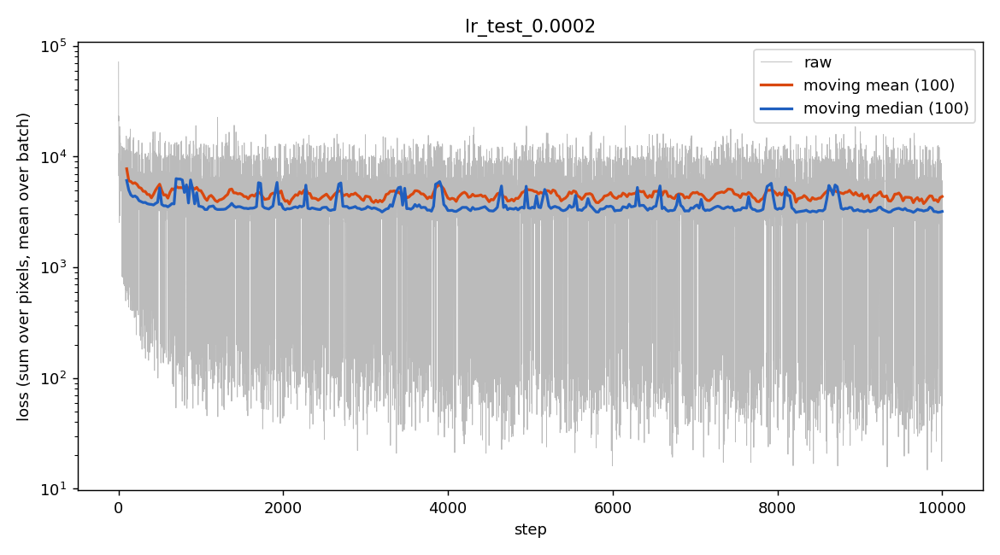
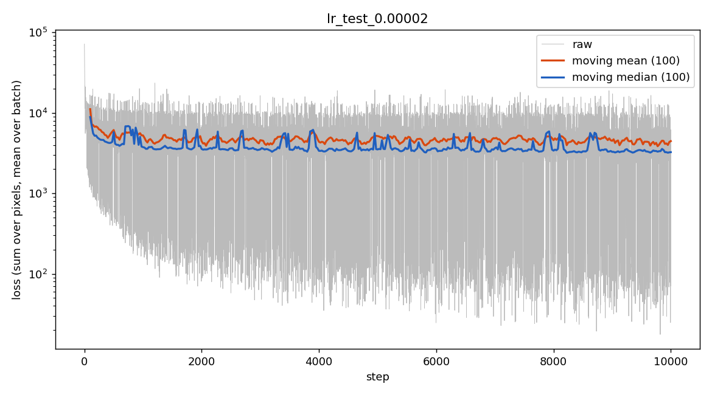
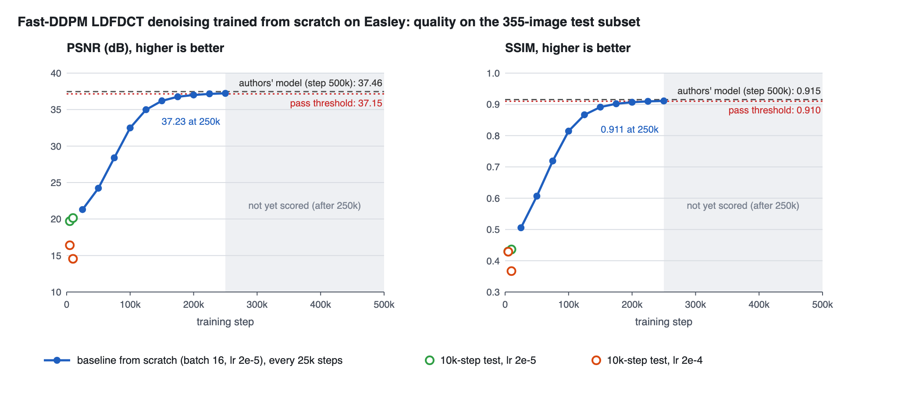
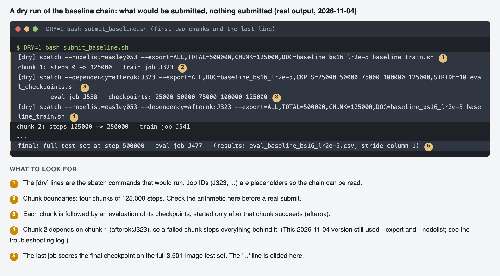
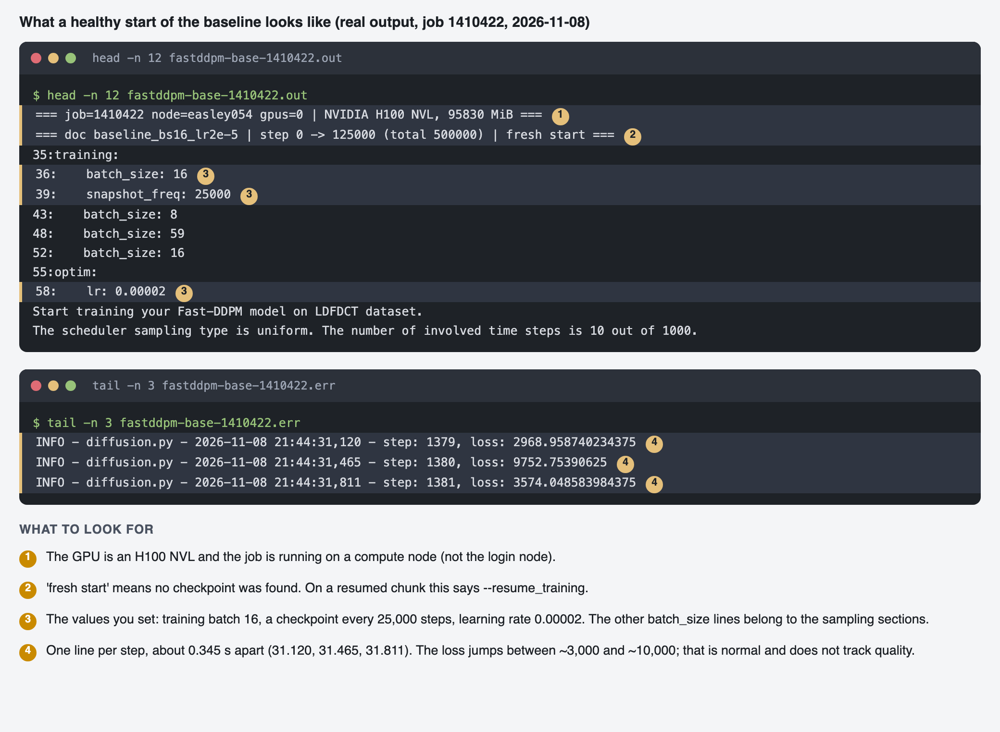
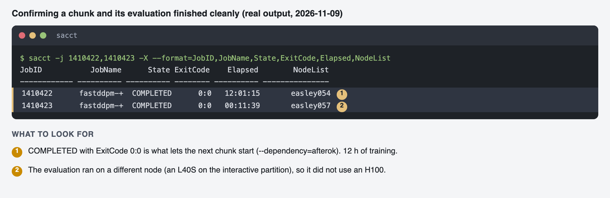
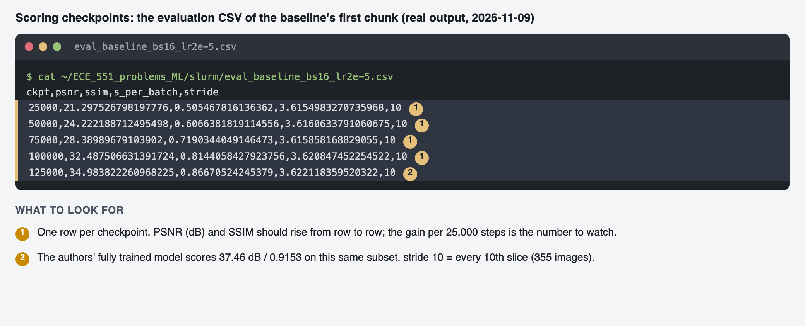

# Running This Project on Easley: Options and Bounds

Read this to decide **how to run** something (which partition, GPU, job shape and
script) and to see **what limits apply** before you plan a run. It sits on top of
[hpc_tutorial.md](hpc_tutorial.md) (setup and troubleshooting) and
[easley_cluster_notes.md](easley_cluster_notes.md) (raw cluster facts).
Recorded 2026-11-03. Statuses: **confirmed** (seen in a log or command output),
**computed** (derived from confirmed numbers), **unverified** (not checked),
**proposed** (a decision waiting for the project owner).

---

## 1. Which way should I run it?

| I want to... | Run it as | Where | Script |
|---|---|---|---|
| Check the environment, debug a script (minutes) | Interactive session | `interactive` (4 h, one node per user) | `srun --partition=interactive --gres=gpu:l40s:1 --time=00:30:00 --pty bash` |
| Reproduce the paper's inference numbers | Single job | `interactive`, 1 L40S | `ldfdct_smoke_test.sh` |
| Score a checkpoint (PSNR/SSIM) | Single job, or chained | `interactive`, 1 L40S | `eval_checkpoints.sh` (`DOC`, `CKPTS`, `STRIDE`) |
| Smoke-test training or resume | Single job | `interactive`, 1 L40S, batch 8 | `ldfdct_train_smoke.sh`, `ldfdct_train_resume.sh` |
| Measure the batch-size limit | Array, one task per size | `l40s` or `h100` | `bs_limit_test.sh` (`BS_SIZES`) |
| Compare settings on short runs (learning rate) | Array, one task per setting; tasks run side by side | `h100`, 1 GPU each | `lr_test.sh` |
| Train at the paper's batch size of 16 | Single GPU job | **`h100` only**: batch 16 does not fit one L40S in fp32 (limit 14) | `baseline_train.sh` |
| Train longer than the 2-day limit allows | **Chain of resumable jobs** (`--dependency=afterok`) | `h100` | `submit_baseline.sh` |
| Probe what loss a known-good model has | Single job | `h100`, 1 GPU, 30 min | `authors_loss_probe.sh` |
| Sweep many configs (step count, scheduler, ...) | Job array | `l40s` or `h100`; concurrency = free GPUs | tutorial section 8 |
| Train on several GPUs at once | One job, `--gres=gpu:<type>:N`, `torchrun` | One node: 2 H100 or 4 L40S | Phase 3: **not built yet** (needs DDP) |
| Train across nodes | `--nodes=2` + `srun torchrun` | multi-node permission **unverified** | Phase 4: **not built yet** |
| View images | Colab, or the notebook on Easley JupyterHub | | `notebooks/fast_ddpm_viewer.ipynb` |

Never submitted a job? Start with [slurm_first_script.md](slurm_first_script.md).

How the job shapes differ (single job, array, dependency chain, multi-GPU): see
[hpc_tutorial.md section 5a](hpc_tutorial.md).

**Rules that decide the choice**
1. **Needs batch 16 or more in fp32?** H100. The L40S ceiling is 14.
2. **Needs more than 2 days of compute?** Chain resumable jobs; never one job.
3. **Needs more than 4 hours?** Not `interactive`. Use `h100` or `l40s`.
4. **Runs have separate output folders and no shared files?** Use an array (parallel).
   **Share a folder or must run in order?** Chain them.
5. **A fresh run deletes its `--doc` folder.** Use `--resume_training` to continue and
   a new `--doc` for every new experiment.

---

## 2. Bounds

### 2.1 Time, GPUs and partitions

| Bound | Value | Status | Source |
|---|---|---|---|
| `h100` partition | 2 days, 4 nodes (easley051-054) x 2 H100 = **8 H100** | confirmed | `sinfo` |
| `l40s` partition | 2 days, 3 nodes (easley055-057) x 4 L40S = **12 L40S** | confirmed | `sinfo` |
| `interactive` | 4 h, **1 node per user** (`QOSMaxNodePerUserLimit`) | confirmed | `sinfo`, `squeue` |
| `debug` | 1 h | confirmed | `sinfo` |
| `scavenger` | 2 days, **preemptible**; adds the other L40S nodes (36 L40S in all) | confirmed | `sinfo` |
| `general` | 2 days, **CPU only** | confirmed | `sinfo`, `scontrol show partition general` |
| `extended` QOS | 5 days, but `cpu=1`, 1 job | confirmed | `sacctmgr show qos` |
| Per-user CPU caps (QOS rows `easley-h1+`, `easley-l4+`, `easley-in+`, `easley-de+`, `easley-ge+`) | 64, 96, 64, 128 and 512 CPUs. The names are truncated, so the mapping to h100 / l40s / interactive / debug / general is **assumed**. A training job uses 8 CPUs, so this does not limit us | confirmed (numbers); assumed (names) | `sacctmgr show qos` |
| **Per-user GPU cap** on `h100` / `l40s` | **unknown.** The `gres/...` part of those rows was cut off by column width | unverified | rerun with `MaxTRESPU%70` |
| GPU-hour allocation | No `GrpTRESMins`, `MaxTRESMins`, `MaxWall` or `MaxJobs` on the account's associations. A budget could still exist outside SLURM (a CARC portal) | partly checked | `sacctmgr show assoc user=$USER` |
| Multi-node GPU jobs | allowed or not: **unknown** | unverified | ask the staff |
| Hopper (A100) | Associations name `hopper-*`, `wheeler`, `xena`; login and job access **unverified** | unverified | see cluster notes section 6 |
| Held jobs | Jobs on the H100 nodes submitted with `--export=ALL,VAR=...` were held ("user env retrieval failed requeued held"). The same job without `--export` ran on `easley051`; variables set in the shell (`VAR=x sbatch ...`) also worked. Tested once per case, 2026-11-08 | confirmed (one A/B test) | `scontrol show job`, tutorial troubleshooting log |
| H100 node states, 2026-11-08 | `easley051`, `easley054` idle and usable; `easley053` full with others' 8 h jobs; `easley052` down | confirmed | `sinfo -p h100 -N` |

Practical consequences:
- **Don't pin to one node unless needed.** On 2026-11-08 a chain pinned to `easley053` was
  estimated to start 3 hours later while two other H100 nodes were idle. Use
  `NODELIST=` (empty) to unpin and `EXCLUDE=<nodes>` to avoid specific ones.
- **Don't use `--export=ALL,VAR=...` on H100 jobs.** Set variables in the environment of
  the `sbatch` call instead (see the tutorial's troubleshooting log).

### 2.2 GPU memory and batch size

| GPU | Memory | Fp32 batch ceiling | Status |
|---|---|---|---|
| L40S | 44.4 GiB usable | **14** (16 runs out of memory at step 2) | confirmed |
| H100 NVL | 95,830 MiB total, **93.1 GiB usable to PyTorch** (measured by `hello_torch.sh`) | above 32 (not found yet); batch 16 uses about 53 GB | confirmed |

Memory per image is about 3.1 to 3.2 GB plus about 2.7 GB fixed (**computed**).
Inference batch: 16 on L40S (128 runs out of memory).

### 2.3 Speed and cost

Measured, fp32, default PyTorch settings, training:

| GPU | Batch | s/step | images/s | Status |
|---|---:|---:|---:|---|
| L40S | 8 | 0.509 | 15.7 | confirmed |
| L40S | 14 | 0.894 | 15.7 | confirmed |
| H100 | 16 | 0.342 | 46.8 | confirmed |
| H100 | 32 | 0.658 | 48.6 | confirmed |

Throughput is flat in batch size, so **time = steps x batch x (0.063 s on L40S, 0.021 s on H100)**.

| Run | Time | Status |
|---|---|---|
| 10,000 steps, batch 16, H100 | about 1 h (measured: 29 min per 5,000 steps) | confirmed |
| **500,000 steps, batch 16, H100** | **about 47.5 h** (500,000 x 0.342 s) | computed |
| 400,000 steps, batch 16, H100 (the paper's stated count) | about 38 h | computed |
| 500,000 steps at batch 14, L40S | about 124 h; not the paper's batch size | computed |
| Score a checkpoint, stride 10 (355 images) | about 1.7 min of sampling plus about 30 s of startup (L40S) | confirmed |
| Score a checkpoint, full set (3,501 images) | about 16 min on an L40S | confirmed |
| Checkpoint write | 1.7 GB per file; about 35 s stall per save measured before the patch (two files written then) | confirmed |

Adding GPUs, bf16, `channels_last` or `torch.compile` can cut these; none is
measured yet (Phases 2 to 4).

### 2.4 Storage

| Location | Limit | Used by this project | Status |
|---|---|---|---|
| Home `/users/lc2025` | **100 GB soft, 200 GB hard**; about 4.3 M files | 36 GB, 191k files (contents not itemised) | confirmed (`quota -s`) |
| Scratch `/carc/scratch` (via `~/carc-scratch`) | Shared 1.2 PB, 509 TB free. **Per-user quota unknown** (`lfs` is not installed) | 13 GB data, 11 GB experiments | confirmed (`df`, `du`) |
| Scratch purge policy | unknown | | unverified |
| Baseline run, 20 checkpoints | about 34 GB on scratch | | computed |

Keep data and checkpoints on scratch, never in git and not in home. If scratch is
purged, a copy of the key checkpoints in home (about 1.7 GB each) is the insurance.

---

## 3. What the experiments have established

### 3.1 The authors' checkpoint (inspected 2026-11-03)

| Fact | Value | How found |
|---|---|---|
| Training step / epoch | **500,000** / 605 | `states[3]`, `states[2]` |
| Optimizer | Adam, **lr 2e-5**, betas (0.9, 0.999), eps 1e-8, weight decay 0, no AMSGrad | `states[1]["param_groups"][0]` |
| Steps per epoch | about 826. With the paper's 13,211 training pairs, 13,211 / 16 = 826, so **the authors used batch 16** | computed |
| Loss under our training loop (300 steps) | median 3,288, mean 4,180 | `authors_loss_probe.sh` |
| Score on the full test set | PSNR 37.457, SSIM 0.9155 | `ldfdct_smoke_test.sh` |
| Score on the stride-10 subset (355 images) | PSNR 37.464, SSIM 0.9153 | `eval_checkpoints.sh` |

The paper states 400,000 iterations; the released checkpoint is at 500,000. The
code does not stop at either number (`n_iters` is unused), so the stop point is
ours to set. The paper also says lr 2e-4, but the checkpoint's optimizer holds 2e-5.

### 3.2 Learning-rate test (10,000 steps, batch 16, one H100 each, same seed)

Job array 1398929, scored with `eval_checkpoints.sh` (stride 10, 355 images):

| lr | PSNR / SSIM at 5,000 | PSNR / SSIM at 10,000 | Median training loss, steps 9,500-10,000 |
|---|---|---|---|
| 2e-4 | 16.40 / 0.4290 | **14.55 / 0.3669** (got worse) | 3,251 |
| 2e-5 | 19.70 / 0.4296 | **20.14 / 0.4360** | 3,313 |
| authors (step 500,000) | | 37.46 / 0.9153 | 3,288 |

Conclusions:
- **Use 2e-5.** It matches the repo, the authors' stored optimizer state and the
  better result here (one seed, 2.5% of a full run, so moderate confidence).
- **Training loss cannot rank models here.** Our 10,000-step models and the
  500,000-step authors' model sit at the same loss (about 3,300), yet score 14 to 20 dB
  against 37.5 dB. Use PSNR/SSIM on held-out data to monitor progress and choose settings.
- **Our training loop and data are equivalent to the authors'**: a trained model gets
  the same loss through them. This rules out a pipeline bug as the cause of the gap.
- **Not yet explained:** how fast PSNR rises over a long run. The baseline run answers it (3.3).

Training loss of the two runs (grey = raw, orange = moving mean, blue = moving median; same seed,
so the bumps line up): both plateau within a few hundred steps and look almost identical, which
is why loss could not choose between the learning rates.

### 3.3 Baseline trajectory (from scratch, batch 16, lr 2e-5, one H100; stride-10 subset)

Chunk 1 (job 1410422, 12:01:15 on `easley054`) and its eval (job 1410423, 11:39 on `easley057`):

| Step | PSNR (dB) | SSIM | Gain over previous 25k steps (dB) |
|---:|---:|---:|---:|
| 25,000 | 21.30 | 0.5055 | |
| 50,000 | 24.22 | 0.6066 | +2.9 |
| 75,000 | 28.39 | 0.7190 | +4.2 |
| 100,000 | 32.49 | 0.8144 | +4.1 |
| 125,000 | 34.98 | 0.8667 | +2.5 |
| authors' checkpoint (step 500,000) | 37.46 | 0.9153 | |

(Regenerate with `python3 docs/images_src/build_images.py` after copying new eval CSVs into
`docs/results/`; the chunks not yet run are shaded.)

- **Training works from scratch in our setup.** PSNR rises steadily; the 10,000-step LR test
  (20.14 dB) sits at the start of this curve.
- **Checkpoints arrived every 2 h 24 min** (25,000 steps), so 0.345 s/step held for the whole chunk.
- **The 25 dB early-warning cutoff was too crude.** At 50,000 steps PSNR was 24.22, below the
  cutoff, yet the run was gaining 3 to 4 dB per 25,000 steps. We continued. The cutoff was a
  judgment made without a reference curve; a slope rule is better (see section 4).
- **Gains are shrinking** (+4.1, then +2.5 dB). Five points do not support a prediction of the
  final value; the remaining chunks will show whether it reaches the threshold.

---

## 4. Baseline plan (from scratch, paper settings)

| Setting | Value |
|---|---|
| Hardware | one H100 per chunk |
| Batch / lr / scheduler | 16 / 2e-5 / uniform, 10 time steps |
| Length | 500,000 steps (the authors' checkpoint step) in 4 chunks of 125,000 (about 12 h each, 14 h limit) |
| Checkpoints | every 25,000 steps (`ckpt_<step>.pth` plus a `ckpt.pth` link) |
| Monitoring | PSNR/SSIM on the stride-10 subset at every checkpoint; full test set at the end |
| Launch | `DRY=1 bash submit_baseline.sh`, then `NODELIST= EXCLUDE=easley052 bash submit_baseline.sh`, from the `slurm` folder (the node pin and the exclude list depend on the day's node states; see 2.1) |
| Launch record | Submitted 2026-11-08 as jobs 1410422 (chunk 1) to 1410430; chunk 1 started on `easley054` at about 21:36, 0.345 s/step. Two earlier submissions were cancelled before starting: a pinned one (waiting on busy `easley053`) and one held by the `--export` problem |
| Results | `slurm/eval_baseline_bs16_lr2e-5.csv` (columns: ckpt, psnr, ssim, s_per_batch, stride) |

**Pass/fail thresholds (proposed, not yet confirmed by the project owner):**
- Final, full test set: **PSNR at least 37.15 and SSIM at least 0.910**
  (within about 0.3 dB / 0.005 of the reproduced 37.457 / 0.9155).
- Early warning (original, absolute): if PSNR is still **below about 25 dB at 50,000 steps**,
  stop and investigate. This was a judgment made without a reference curve. On the real run it
  was tripped (24.22 dB) while PSNR was rising 3 to 4 dB per 25,000 steps, so the run continued.
- Early warning (**proposed replacement**, for future runs): continue while PSNR gains at least
  about 1 dB per 25,000 steps; investigate if the gain over two consecutive checkpoints is under
  0.5 dB before the run is within about 3 dB of the target. Not yet confirmed by the project owner.

### 4.1 What to expect

The dry run, before submitting (nothing is queued; job IDs are placeholders):

The start of a healthy chunk, from its `.out` and `.err` files:

After a chunk and its evaluation finish:

**Restarting.** Chunks use `afterok`, so a failed or timed-out chunk leaves the next
ones pending as `DependencyNeverSatisfied`.
1. `scancel` the stuck jobs.
2. Check the last checkpoint: `ls -l ~/carc-scratch/fastddpm-exp/logs/baseline_bs16_lr2e-5/`.
3. Rerun `bash submit_baseline.sh`. Each job computes its target from the latest
   `ckpt.pth`, and a job already past the total exits at once. Duplicate rows in the CSV
   are harmless.

A crash costs at most the steps since the last checkpoint (up to 25,000, about
2.4 h).

---

## 5. Before you launch a long run

- [ ] The training-controls patch is applied to the fork on the cluster
      (`grep -c max_steps fast-ddpm/fast_ddpm_main.py` is at least 1).
- [ ] `DRY=1 bash submit_baseline.sh` prints 4 train jobs and 5 eval jobs.
- [ ] Scratch space for the checkpoints (about 34 GB) and a purge plan.
- [ ] Hours: about 48 H100-hours plus evals fit your allocation (**ask the staff**; no cap visible in SLURM).
- [ ] The pass/fail thresholds are agreed and written down above.
- [ ] You know which node the job pins to and what to do if it queues (`squeue --start`).

## 6. Still unknown

| Item | How to settle it |
|---|---|
| Per-user GPU cap on `h100` and `l40s` | `sacctmgr show qos format=Name%22,MaxWall,MaxTRESPU%70,MaxJobsPU,GrpTRES%40 \| grep -iE "name\|easley"` |
| Scratch purge policy and per-user quota | CARC documentation or staff |
| GPU-hour allocation outside SLURM | staff |
| Multi-node GPU jobs allowed | staff; decides how far Phase 4 can go |
| H100 batch ceiling above 32; `max_memory_allocated` | Phase 0 |
| Why `--export=ALL,VAR=...` makes H100 jobs fail env retrieval (a workaround exists; the cause on the node side is not known) | staff |
| Hopper access | cluster notes section 6 |

---

## 7. Why launching was hard: causes found, in the order they bit

Why the baseline runs as a **chain** at all: it needs about 47.5 h on one H100 against a
48 h partition limit, so one job has no margin, and a crash would cost the whole run. Four
12 h chunks cost nothing in speed (chunk 2 started within a minute of chunk 1 ending) and
a failure loses at most one chunk. The cost is that each chunk must win a GPU again.

| Symptom | Real cause | How it was established | Fix |
|---|---|---|---|
| GPU job sent to `general` | `general` is CPU-only | `sinfo` | use `h100`, `l40s` or `interactive` |
| Array tasks pending one by one on `interactive` | one node per user (`QOSMaxNodePerUserLimit`) | `squeue` reason | chain, or use `h100` / `l40s` for arrays |
| `srun` killed during `pip install` | install tied to the allocation's walltime | job log | install on the login node |
| `ModuleNotFoundError`, NumPy / opencv errors | the upstream README omits dependencies; NumPy 2 breaks torch 2.2.2 | failed jobs | pins in the tutorial section 4 |
| Out of memory, inference batch 128 / training batch 16 on L40S | configs tuned for 80 GB cards | job logs, batch-size tests | batch 16 for inference, H100 for training batch 16 |
| H100 jobs held, `user env retrieval failed requeued held` | **`--export=ALL,VAR=...`** on H100 nodes (first misread as a bad-node problem) | A/B test on `easley051`, 2026-11-08 | pass variables through the shell environment |
| Chain waited hours with idle GPUs elsewhere | pinned to `easley053`, which two other jobs filled; `easley051` / `easley054` were idle | `squeue -p h100`, `sinfo -p h100 -N` | unpin; `EXCLUDE=` for a down node |
| Chain would continue after a crash | job exit code was `ls`'s, not Python's | script review before launch | `RC=$?` and `exit $RC` |
| Learning rate misread | PyYAML parses `2e-5` as a string | review | write `0.00002` |

Lesson recorded: when a job fails to start, check what is on the nodes and run a small
controlled test that changes one thing, before choosing a workaround. The pin to one node
came from a wrong guess and cost hours.
