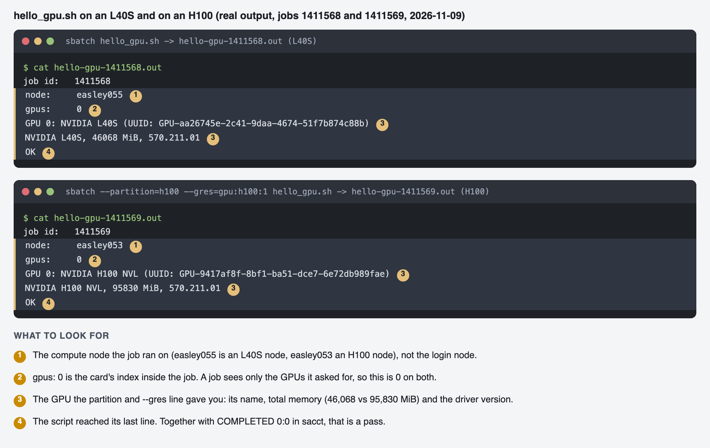
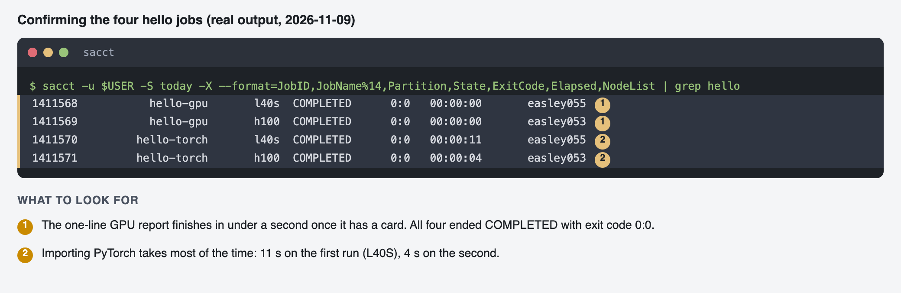
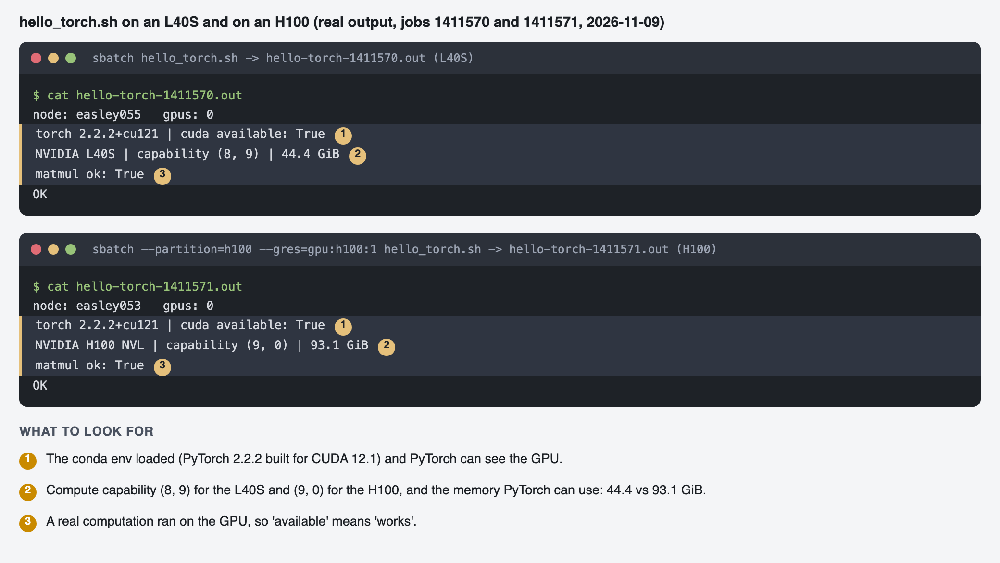

# Your First SLURM Script: L40S or H100

The smallest GPU job that works on Easley, how to point it at an L40S or an H100, and how to read
what comes back. Everything here was run on this cluster unless marked **general SLURM behavior**
(true of SLURM, not separately measured here). For the reasons behind the choices see
[run_options_and_bounds.md](run_options_and_bounds.md); for troubleshooting see the log in
[hpc_tutorial.md](hpc_tutorial.md).

`<...>` marks a value to replace. Do not paste it literally into the shell.

---

## 1. What a SLURM script is

A text file with three parts, in this order:

```bash
#!/bin/bash                       # 1. the interpreter
#SBATCH --job-name=hello-gpu      # 2. requests to the scheduler: one #SBATCH line each
#SBATCH --partition=l40s
#SBATCH --gres=gpu:l40s:1
...
echo "node: $(hostname)"          # 3. the commands that run on the compute node
nvidia-smi -L
```

- **Part 2 is a request, not a command.** SLURM reads the `#SBATCH` lines, finds a node that matches,
  and starts part 3 there, later, unattended. It only reads `#SBATCH` lines that come **before the
  first command**; one placed after is silently ignored.
- **The job runs in a fresh shell on a compute node, not in your terminal.** Anything it needs
  (conda, paths) must be in the script. Its output goes to files, not your screen.

## 2. The simplest script

[`slurm/hello_gpu.sh`](../slurm/hello_gpu.sh): reports which node and GPU it got, then exits. No conda,
no data.

```bash
#!/bin/bash
#SBATCH --job-name=hello-gpu
#SBATCH --partition=l40s
#SBATCH --gres=gpu:l40s:1
#SBATCH --cpus-per-task=4
#SBATCH --mem=16G
#SBATCH --time=00:05:00
#SBATCH --output=hello-gpu-%j.out
#SBATCH --error=hello-gpu-%j.err

echo "job id:   $SLURM_JOB_ID"
echo "node:     $(hostname)"
echo "gpus:     $CUDA_VISIBLE_DEVICES"
nvidia-smi -L
nvidia-smi --query-gpu=name,memory.total,driver_version --format=csv,noheader
echo OK
```

## 3. Choosing the GPU: what to put in the script

You change **two lines**: the partition and the GPU request. Everything else stays the same.

| Line | L40S | H100 |
|---|---|---|
| `#SBATCH --partition=` | `l40s` (2-day limit) | `h100` (2-day limit) |
| `#SBATCH --gres=` | `gpu:l40s:1` | `gpu:h100:1` |
| What `nvidia-smi` reports | NVIDIA L40S | NVIDIA H100 NVL |
| GPU memory | 46,068 MiB (44.4 GiB usable to PyTorch) | 95,830 MiB (93.1 GiB usable to PyTorch) |
| GPUs per node | 4 | 2 |
| Cards you can get at once | 12 in `l40s` (more only through preemptible `scavenger`) | 8 in `h100` |
| Training speed (this project) | 1x (about 15.7 images/s) | 2.5x to 2.9x (about 47 images/s) |
| Largest fp32 training batch (this project) | **14** | above 32 (the paper's 16 fits) |

**Two ways to switch, with no difference in result:**

```bash
# A. edit the two lines in the file, then
sbatch hello_gpu.sh

# B. leave the file alone and override on the command line (command-line options beat #SBATCH lines)
sbatch hello_gpu.sh                                            # L40S (the file's defaults)
sbatch --partition=h100 --gres=gpu:h100:1 hello_gpu.sh         # H100
```

**Quick test on a time-limited partition.** For checks under 4 hours, `--partition=interactive` with
`--gres=gpu:l40s:1` also works; it allows one node per user, so a second job you start there waits.
The same applies to `debug` (1 hour).

**Which GPU should I pick?**
- Training at the paper's batch size of 16, or anything that does not fit in 44 GiB: **H100**.
- Scoring checkpoints, inference, debugging, small experiments: **L40S** (plentiful, and it leaves
  the H100s free).
- Not sure: run the same script on both. It takes minutes.

### 3.1 Where your code runs: login node, L40S job, H100 job

The same command can behave very differently depending on where it runs. **Confirmed** = seen on
this cluster; **expected** = follows from the setup but not separately tried; **untested** = unknown.

| | Login node (your terminal) | L40S job | H100 job |
|---|---|---|---|
| GPU | none | 1 L40S (a node has 4) | 1 H100 NVL (a node has 2) |
| `nvidia-smi` | fails: "couldn't communicate with the NVIDIA driver" (confirmed) | works | works |
| `torch.cuda.is_available()` | `False` (expected) | `True` | `True` |
| When it starts | at once; you are typing | after the queue | after the queue; the H100s are often busy with others' 8 h jobs (confirmed on 2026-11-08) |
| Time limit | none for your shell, but heavy work is discouraged and may be stopped (policy **untested**) | `--time`; `l40s` up to 2 days, `interactive` 4 h | `--time`, up to 2 days |
| Memory it can use | RAM shared with every other user | your `--mem` (we use 32G) plus **44.4 GiB** of GPU | your `--mem` plus **93.1 GiB** of GPU |
| Environment | conda env already active in your shell | fresh shell: `source ~/.bashrc; conda activate fastddpm` | same |
| Internet (pip, git, gdown, curl) | works; every download in this project was done here | **untested** | **untested** |
| Where output goes | your screen | `.out` / `.err` files | same |
| Files | `~` and `~/carc-scratch` are the same on every node (confirmed) | | |
| Good for | git, `scp`, editing, `pip`/`conda` installs, submitting jobs, plotting loss curves, reading a checkpoint's metadata (a 1.7 GB load worked here) | inference, scoring checkpoints, debugging, small experiments | training at the paper's batch size, long runs |

- **CPU-heavy work belongs in a job, not the login node.** The `general` partition is CPU-only
  (2 days, up to 512 CPUs per user), so use it for anything long that needs no GPU.
- **Package installs stay on the login node.** An install inside a GPU allocation was killed by that
  allocation's walltime (see the troubleshooting log).
- **A missing `conda activate` is the most common surprise.** `matplotlib` was "not installed" on the
  login node until the env was activated; a batch job never has it active unless the script does it.

**What differs between the L40S and the H100, beyond speed**

| Difference | L40S | H100 | Consequence |
|---|---|---|---|
| GPU memory | 44.4 GiB usable | 93.1 GiB usable | training batch 16 runs out of memory on the L40S (limit 14) and fits the H100 |
| When a memory error shows | at step 2: step 1 fits, then Adam and EMA state is allocated | not seen up to batch 32 | a job can look healthy for a moment and then fail |
| Speed (fp32 training) | about 15.7 images/s | about 47 images/s (2.5x to 2.9x) | 500,000 steps at batch 16 is about 47.5 h on one H100 |
| Throughput vs batch size | flat from batch 4 | flat from about batch 12 | a bigger batch does not make either card faster |
| GPUs per node | 4 | 2 | a one-node multi-GPU job can use 4 L40S or 2 H100 |
| Cards available without preemption | 12 (36 if you accept `scavenger`) | 8 | the H100s are the scarcer resource |
| Compute capability | (8, 9) | (9, 0) | PyTorch 2.2.2+cu121 supports both; the paper's 1.12.1 supports neither |
| `--export=ALL,VAR=...` | works (our eval jobs on `interactive` use it) | jobs held with `user env retrieval failed` (tested on `easley051`) | on the H100, set variables in the shell: `VAR=x sbatch script.sh` |
| `nvidia-smi` memory reading | rises steadily with batch size | not monotonic: batches 8 and 10 read higher (46.5 and 49.7 GB) than batch 12 (41.6 GB), probably from PyTorch's memory caching | use `torch.cuda.max_memory_allocated()` for a true figure |

**Not measured here:**
- Whether the **same weights score slightly differently** on the two GPUs. The baseline trains on the
  H100 but is scored on L40S nodes; small numerical differences between GPU types are normal
  (general behavior) and have not been quantified.
- Whether **inference batch 128** (the paper's value) fits on the H100. It fails on the L40S.
- **Interconnect** between GPUs (NVLink or not), which matters for multi-GPU training.

**How to tell where you are**

```bash
hostname              # login node name, or easleyNNN on a compute node
echo $SLURM_JOB_ID    # empty on the login node; a number inside a job
nvidia-smi -L         # "GPU 0: NVIDIA L40S ..." or "NVIDIA H100 NVL ...", or an error on the login node
python -c "import torch; print(torch.cuda.is_available())"
```

## 4. The other lines, in plain words

| Line | Meaning | Value used here | Notes |
|---|---|---|---|
| `--job-name=` | label shown in `squeue` | `hello-gpu` | the default `squeue` view truncates long names |
| `--cpus-per-task=` | CPU cores for your process | 4 (8 for real training) | a node has 64; ask for what you use |
| `--mem=` | system RAM | 16G (32G for training) | not GPU memory; the GPU's is fixed by its type |
| `--time=` | longest the job may run | `00:05:00` | format `HH:MM:SS` or `D-HH:MM:SS`; hitting it kills the job (`TIMEOUT`) |
| `--output=` / `--error=` | where stdout / stderr go | `hello-gpu-%j.out` / `.err` | `%j` = job id; in job arrays use `%A_%a` |

- **Python's `logging` goes to the `.err` file**, not `.out`. In this project the training step
  lines are in `.err`; look there first when `.out` seems empty.
- **Request only what you need.** Asking for less, and for a shorter time, is easier for the
  scheduler to place (**general SLURM behavior**).
- **Time limits per partition:** `h100` and `l40s` 2 days, `interactive` 4 hours, `debug` 1 hour.
  `general` is CPU-only; never send a GPU job there.

## 5. Submit it and watch it

```bash
cd ~/ECE_551_problems_ML/slurm
sbatch hello_gpu.sh
```

Prints one line, `Submitted batch job <number>`. That number is the job id.

```bash
squeue --me                                  # my jobs: state, node, why it is waiting
sacct -j <jobid> -X --format=JobID,JobName,State,ExitCode,Elapsed,NodeList   # after it ends
cat hello-gpu-<jobid>.out                    # what it printed
cat hello-gpu-<jobid>.err                    # errors (empty is good)
scancel <jobid>                              # stop it
```

**The state letters in `squeue`:**

| `ST` | Meaning | What to do |
|---|---|---|
| `PD` with `(Resources)` | waiting for a free GPU | wait; check `squeue --me --start` |
| `PD` with `(Dependency)` | waiting for another job (chains only) | nothing |
| `PD` with `...held` | SLURM gave up starting it | `scancel` it and read [section 7](#7-things-that-go-wrong) |
| `R` | running | read the output files |
| (gone from the list) | finished or failed | `sacct -j <jobid>`: `COMPLETED 0:0` is success |

**What a good result looks like.** Real output of `hello_gpu.sh` on each GPU (jobs run 2026-11-09):



Then confirm the jobs finished cleanly. `COMPLETED` with exit code `0:0` is success, and each
ran for seconds:



The only differences between the two runs are the node, the GPU name and the memory: 46,068 MiB on the
L40S and 95,830 MiB on the H100 NVL. Both report the same driver version (570.211.01). `gpus: 0` is the
card's index inside the job, so it reads 0 on both.

## 6. Step two: add conda and PyTorch

[`slurm/hello_torch.sh`](../slurm/hello_torch.sh) is the same job with the two things every real script
needs: load your environment, then run Python.

```bash
source ~/.bashrc          # a batch job starts a fresh shell: load conda first
conda activate fastddpm
python - <<'PY'
import torch
print(torch.__version__, torch.cuda.is_available(), torch.cuda.get_device_name(0))
PY
```

```bash
sbatch hello_torch.sh                                          # L40S
sbatch --partition=h100 --gres=gpu:h100:1 hello_torch.sh       # H100
```

Real output (jobs run 2026-11-09):



PyTorch 2.2.2 built for CUDA 12.1 sees both cards. The compute capability is `(8, 9)` for the L40S and
`(9, 0)` for the H100, which is why PyTorch 2.2.2 is used here: the paper's 1.12.1 has no kernels for
either. PyTorch can use **44.4 GiB** on the L40S and **93.1 GiB** on the H100. The last line should
be `OK`. Importing PyTorch is most of the run time (11 s on the L40S, 4 s on the H100).

## 7. Things that go wrong

| Symptom | Cause | Fix |
|---|---|---|
| `bash: gpu_partition: No such file or directory` | a `<placeholder>` pasted literally | replace the whole `<...>` with a real value |
| Job never starts, reason `(Resources)` for hours | every matching GPU is busy, or you pinned a node | `sinfo -p h100 -N -o "%N %t %G %C"` and `squeue -p h100`; do not pin with `--nodelist` unless needed |
| Job held: `user env retrieval failed requeued held` | on the H100 partition, `sbatch --export=ALL,VAR=...` | resubmit without `--export`; set variables in the shell: `VAR=x sbatch script.sh` |
| `nvidia-smi` fails with "couldn't communicate with the NVIDIA driver" | you ran it on the login node | run it inside a job, or `srun --pty` |
| `.out` and `.err` empty, state `COMPLETED` very fast | the `#SBATCH` lines came after a command, or the script exited early | put all `#SBATCH` lines at the top; read `.err` |
| State `TIMEOUT` | the job ran past `--time` | raise `--time` (within the partition limit) |
| `ModuleNotFoundError` / `conda: command not found` | the batch shell did not load conda | `source ~/.bashrc` then `conda activate <env>` at the top of the commands |
| No output file appears | the folder named in `--output` does not exist (**general SLURM behavior**) | create it first, or write to the current folder |
| `CUDA out of memory` | the job needs more GPU memory than the card has | lower the batch size, or use the H100 |

## 8. What to try next

1. Run `hello_gpu.sh` on **both** GPUs and compare the `.out` files.
2. Run `hello_torch.sh` on both.
3. Then read the real scripts: `slurm/ldfdct_smoke_test.sh` (inference), `slurm/lr_test.sh` (a
   2-task job array) and `slurm/baseline_train.sh` (one chunk of a chained run). Each is this
   same shape with a longer `--time`, more memory, and a Python command in place of the `echo`s.
4. To choose partition, GPU and job shape for a task, use [run_options_and_bounds.md](run_options_and_bounds.md).
